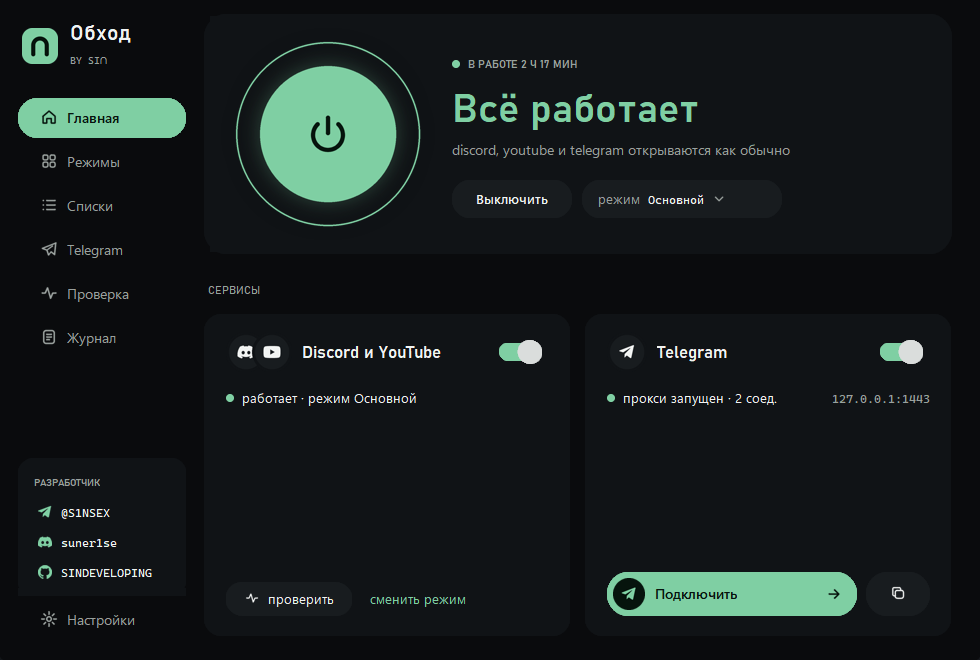
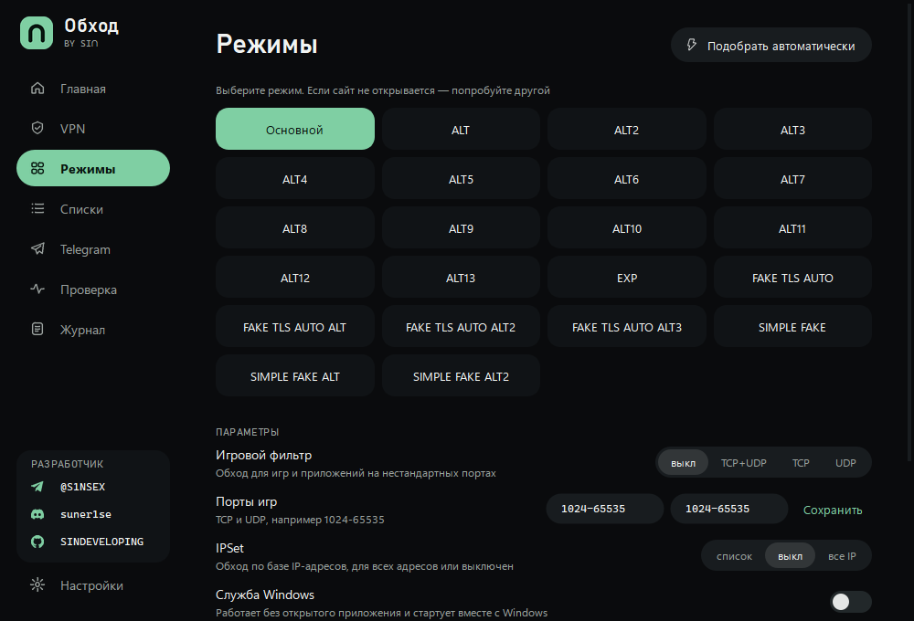
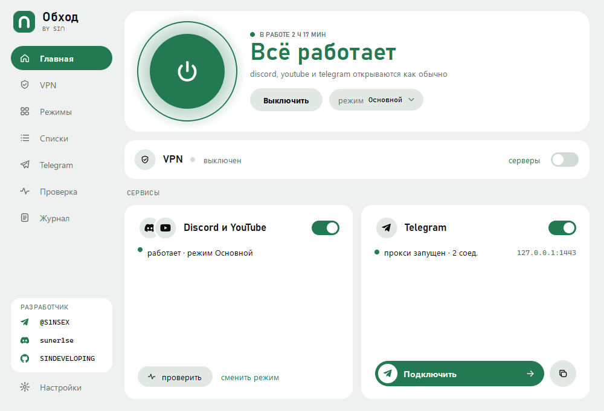
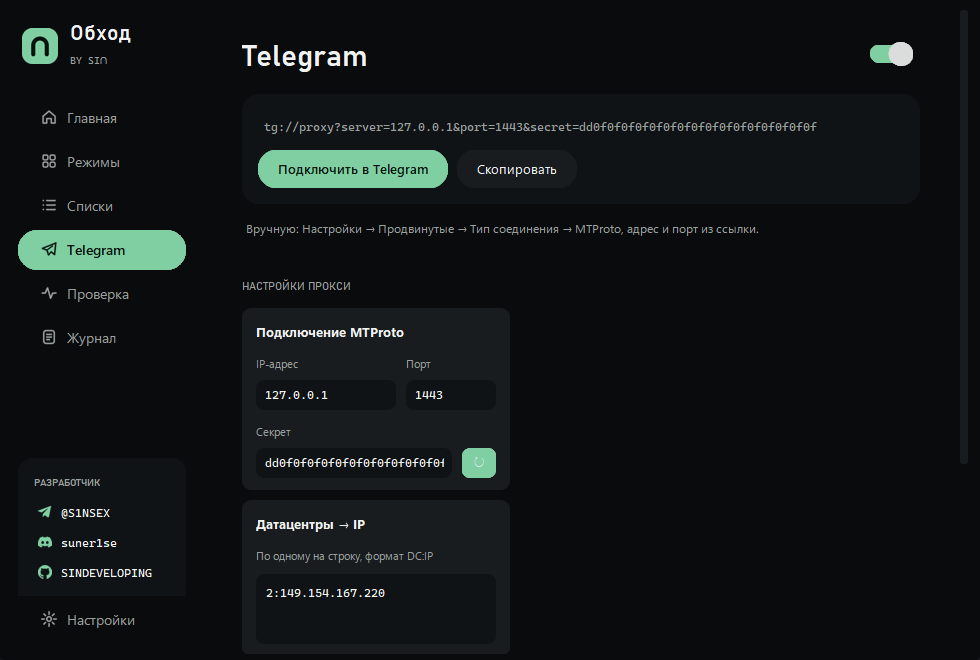

# Обход

**Discord, YouTube и Telegram без блокировок — одной кнопкой. Плюс свой VPN-клиент.**

## Скачать

Откройте [последний релиз](https://github.com/SINDEVELOPING/Obhod/releases/latest) и скачайте
установщик:

- **ObhodSetup-&lt;версия&gt;.exe** — полная версия.
- **ObhodLiteSetup.exe** — Обход Lite для слабых ПК (см. ниже).

Запустите его, нажмите «Установить» — Обход появится на рабочем столе и в меню «Пуск».

> Windows может показать «Система Windows защитила ваш компьютер» — нажмите «Подробнее» →
> «Выполнить в любом случае». Так бывает со всеми программами без платной цифровой подписи.

## Что умеет

### Обход блокировок

- **Discord и YouTube** — обход замедления и блокировок без VPN. Скорость интернета не падает,
  остальные сайты работают напрямую.
- **Telegram** — встроенный прокси, подключается в Telegram одной кнопкой.
- **Подбор режима** — Обход сам проверяет все режимы и предлагает тот, что работает
  у вашего провайдера.
- **Свои списки** — добавьте сайты, которые нужно открывать в обход, или исключения.

### VPN

- **Встроенный VPN-клиент на Xray.** Вставьте ссылку на подписку или ключ
  (vless, vmess, trojan, ss, hysteria2). Два режима: «Весь трафик» и «Прокси».
- **Автовыбор сервера** — если сервер перестал отвечать или тормозит, Обход сам переключится
  на самый стабильный, без разрыва соединения.
- **Приложения через VPN** — выберите программы, которые идут напрямую, или, наоборот,
  пустите через VPN только выбранные.
- **Честный пинг** — задержка измеряется реальным запросом через каждый сервер.
- **Подписка на виду** — остаток трафика и срок действия.

### Удобство

- **Работает в фоне** — сворачивается в трей, может запускаться вместе с Windows
  или работать как служба.
- **Проверка** — находит, что мешает обходу (антивирус, другие обходы, VPN, настройки DNS),
  и чинит в один клик.
- **Восстанавливается сам** — если что-то упало, Обход перезапустится и включит всё обратно.
- **Обновляется сам** — показывает, что нового, и обновляется одной кнопкой, без переустановки.
- **Оформление под себя** — 8 тёмных и светлых тем, свой цвет акцента, обои на фоне окна,
  масштаб, скругления и анимации. Иконка в трее и ярлыки перекрашиваются вместе с темой.

## Обход Lite

Облегчённое издание для слабых и старых компьютеров: Discord и YouTube, VPN и Telegram,
тёмная тема и почти без анимаций. Ставится отдельным установщиком **ObhodLiteSetup.exe**
и обновляется само, как и полная версия.

## Если не работает

1. Выключите сторонние VPN и другие программы обхода (GoodbyeDPI и т. п.) — вместе они мешают
   друг другу.
2. Откройте «Режимы» → «Подобрать автоматически».
3. Откройте «Проверка» → «Проверить всё» и примените предложенные исправления.
4. Не помогло — «Проверка» → «Сохранить отчёт на рабочий стол» и напишите в Telegram
   [@S1NSEX](https://t.me/S1NSEX), приложив отчёт.

## Удаление

«Параметры» → «Приложения» → «Obhod» → «Удалить». Настройки останутся — пригодятся
при повторной установке.

## Требования

Windows 10 или 11, 64-бит, права администратора (нужны драйверу обхода).

## Благодарности

В основе — открытые проекты [zapret-discord-youtube](https://github.com/Flowseal/zapret-discord-youtube)
и [tg-ws-proxy](https://github.com/Flowseal/tg-ws-proxy) (Flowseal), [zapret](https://github.com/bol-van/zapret)
(bol-van), [Xray-core](https://github.com/XTLS/Xray-core) (XTLS) и драйвер
[WinDivert](https://github.com/basil00/WinDivert). Их лицензии —
в [THIRD-PARTY-NOTICES.txt](THIRD-PARTY-NOTICES.txt).

## Лицензия

© 2026 SIN. Все права защищены — см. [LICENSE](LICENSE).
